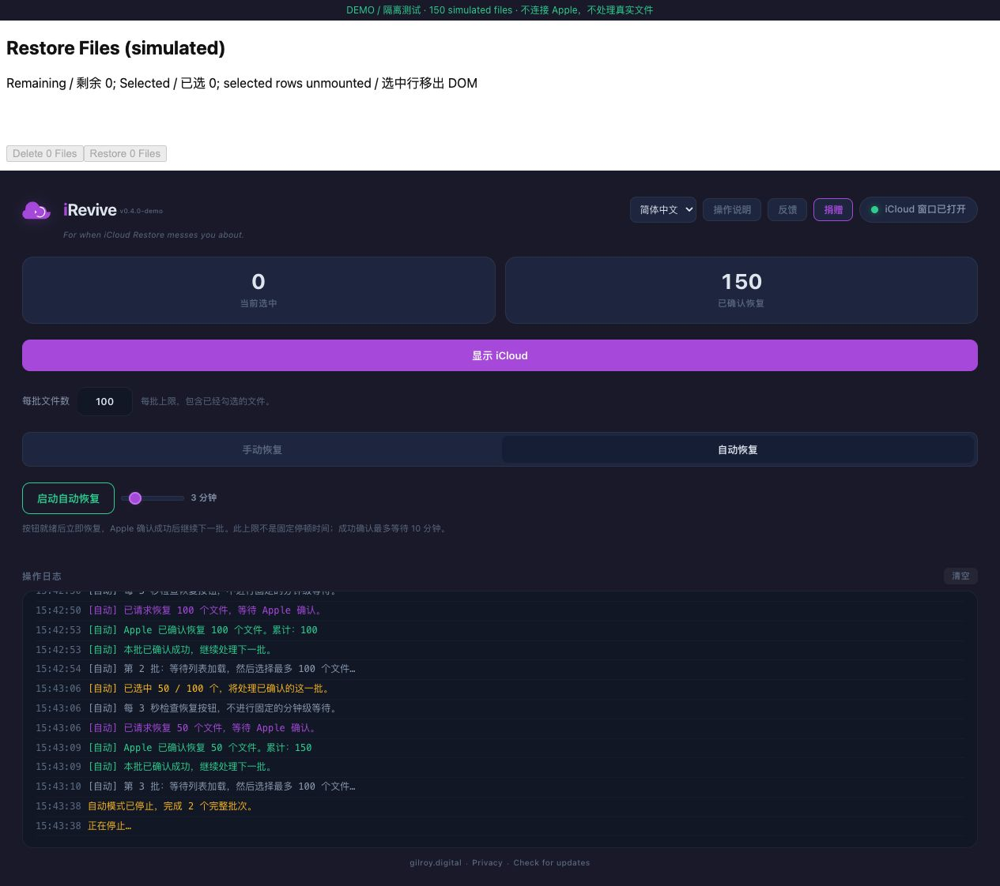

# Localized recovery and reduced waiting / 中文恢复与等待优化

This contribution builds on iRevive by **Leon Gilroy / Gilroy Digital**, from [upstream](https://github.com/Fleebee/irevive-icloud-restore) commit `59f00aa137eee78c85187e7f9e14cf5ec58db7c1`. The original [article](https://gilroy.digital/icloud-file-restore-frozen/index.html) explains the motivation. The application identity, original author credits, donation links, updater and feedback integration are retained. No dependency or release-version changes are required.

本补丁是在原作者项目上修改，不是从零原创。主要解决中文控件识别、列表重建后的选择数量、重复滚动和固定等待；恢复服务仍由 Apple 提供。

## Operation / 操作

Open iCloud → sign in on Apple's page → open Restore Files / 恢复文件 → set Files per batch → Automatic → Start Auto. No manual first batch is required. Default batch size remains 500; start with a smaller batch if the page is slow. The limit includes existing selections and partial verified batches can proceed.

打开 iCloud、在 Apple 窗口登录并进入恢复列表后，设每批上限、启动自动恢复即可。成功后继续下一批，不用每次重启。界面语言与网页语言独立；旧日志保留写入时的语言。不要在公共反馈中发送账户、验证码、Cookie 或私人文件名。

| Stage / 阶段 | Behavior / 行为 |
| --- | --- |
| List / 列表 | Auto waits up to 3 minutes, proceeds once the batch is available; a smaller list can settle earlier. Manual waits up to 30 seconds, followed by checkbox work. |
| Selection / 勾选 | Refresh DOM references in groups of five; direct checkbox clicks skip scrolling; disabled/disconnected controls are skipped. Existing selections count toward the limit. |
| Restore readiness / 按钮可用 | Read-only polling every 3 seconds; slider default 3 minutes, range 1–15, is a maximum wait rather than a fixed sleep. |
| Confirmation / 成功确认 | Submit Restore once, wait up to 10 minutes for a recognized success heading and confirmation button; count only confirmed files. |
| Next batch / 下一批 | A short 1-second transition after confirmation, then wait for the next list as needed. |

Only a recognized success heading and its confirmation button prove success. An enabled footer with `恢复 40 个文件` can supply the count even when selected rows are not rendered. Hidden/disabled controls and the background Restore Files tile are excluded. Confirmation polling never submits Restore again. Stop prevents further actions but cannot withdraw a request already sent to Apple.

“已请求恢复”不等于成功。按钮灰着、报告丢失、加载错误、超时、没有可确认批次时自动停止，等待检查；这不能证明没有剩余文件。确认后再重新启动。取消选择只影响当前渲染的复选框，请检查网页页脚完整数量。

## Verification / 验证

```sh
npm run check
npm test
node --test --experimental-test-coverage --test-coverage-include='**/src/i18n.js' --test-coverage-lines=80 --test-coverage-branches=80 --test-coverage-functions=80 tests/i18n.test.mjs
cargo check --locked --manifest-path src-tauri/Cargo.toml
npm run fixture
python3 -m http.server 8768 --bind 127.0.0.1 --directory artifacts/fixture
```

Open `http://127.0.0.1:8768/?apple=zh-CN` with the English interface, or `?apple=en` with the Chinese interface. Set the batch limit to **100**. The fixture starts with 150 synthetic files and 40 already selected outside the rendered list. Expect one confirmed batch of 100 and another of 50. Selected rows are unmounted; the footer is outside the list-content container. Stop Auto after the two confirmations, or let the empty list wait time out. The fixture blocks external links and replaces the updater check with a no-op.

模拟页面不连接 Apple、无需登录、不修改真实文件。它运行生产前端和从 Rust 源码提取的页面脚本，不能验证 WKWebView、登录、Apple 网络或服务器实际速度。

Regression coverage includes Chinese/English/selected Traditional Chinese labels, formatting characters, footer counts, replaced rows, existing batch limits, disabled/hidden controls, Delete exclusion, cancellation, missing reports, timeouts, no duplicate restore submission, localized controls and UI switching. The new language module is measured separately; no whole-application coverage claim is made.

The change removes fixed pauses and unnecessary scrolling, but has no production throughput benchmark or claimed speed multiplier. Earlier real-file confirmation screenshots from local adaptations do not validate this upstream patch. Test a small real batch with account-owner authorization before a release; check restored files at their original locations.


Recorded on 2026-10-01: 62 targeted tests and frontend syntax checks passed; `cargo check --locked` passed on Apple Silicon macOS. The new language module measured 100% lines/functions and 95.65% branches. Browser verification is against synthetic files only; production throughput is not measured.

Both cross-language browser runs confirmed two synthetic batches of 100 and 50 files. / 两种交叉语言组合均确认了 100＋50 个模拟文件。


